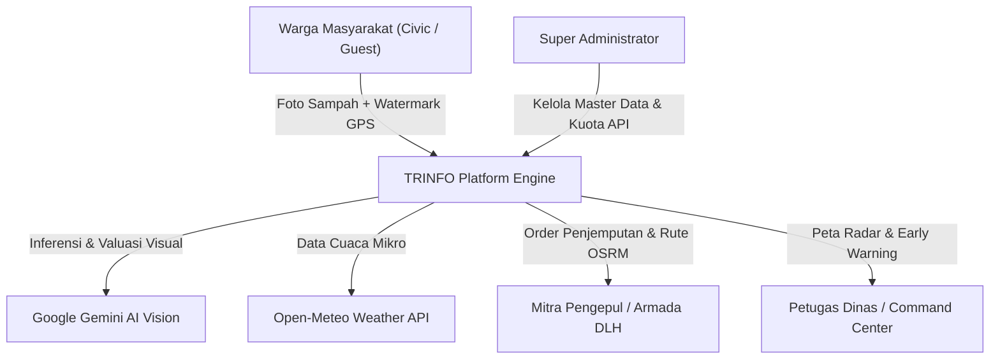
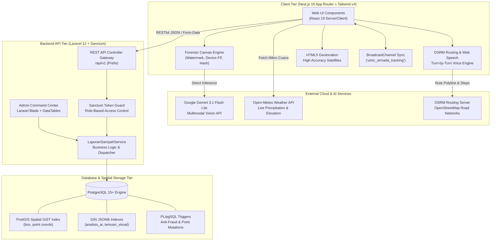
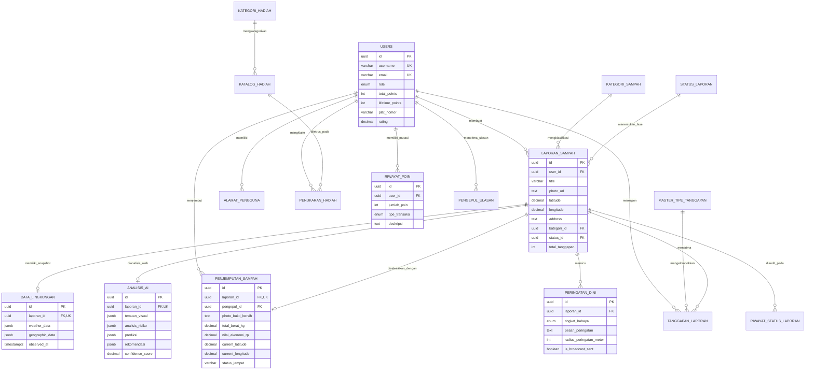

# Dokumen Spesifikasi Produk & Teknis (Product Requirements Document)
## TRINFO (Trash Information System) v2.0
**Dokumen Acuan Penulisan Proposal Web Development Competition UINIC 8.0**  
*Tema: "Engineering Interconnected Web Solutions to Empower Digital Ecosystems"*  
*Subtema: Artificial Intelligence & Teknologi Digital (Berbasis SDGs)*

---

## 1. Ringkasan Proyek

| Atribut | Keterangan |
|---|---|
| **Nama Proyek** | **TRINFO (Trash Information System)** |
| **Tagline** | *Platform Cerdas Pemantauan Sampah Liar, Deteksi Multi-Bahaya Lingkungan Berbasis Multimodal AI Vision, dan Ekosistem Daur Ulang Sirkular Berinsentif.* |
| **Deskripsi Singkat (2-3 Kalimat)** | TRINFO adalah solusi *interconnected web platform* yang memadukan partisipasi warga (*civic crowdsourcing*), visi komputer multimodal AI (Google Gemini), dan data cuaca mikro *real-time* (Open-Meteo) untuk memetakan serta memitigasi timbunan sampah liar, sumbatan drainase pemicu banjir, dan risiko sanitasi perkotaan. Platform ini menghubungkan warga pelapor, armada mitra pengepul daur ulang, dan dinas lingkungan hidup dalam satu rantai pasok sirkular berinsentif poin reward (EcoPoints) dengan rute navigasi terpadu. Seluruh data geospasial dan peringatan dini terintegrasi melalui arsitektur RESTful API terbuka yang siap dihubungkan dengan ekosistem *smart city* perkotaan. |
| **Repositori Resmi** | [GitHub: Virgarakha/UINIC2026-TIS](https://github.com/Virgarakha/UINIC2026-TIS) |
| **Demo / Deployment URL** | **PERLU DIISI MANUAL** *(Tulis URL production Vercel / VPS jika telah di-hosting)* |
| **Developer Portal & API Docs** | `/admin/api-docs` *(Didukung skema langganan & katalog endpoint terstandarisasi)* |

---

## 2. Latar Belakang & Permasalahan

### 2.1 Masalah Nyata di Lapangan
1. **Banjir Luapan Drainase Perkotaan**: Akumulasi sampah anorganik (terutama kantong kresek dan botol plastik) pada gorong-gorong, saluran drainase mikro, dan pilar jembatan sungai kerap luput dari pemantauan berkala hingga curah hujan tinggi datang dan memicu luapan banjir bandang di pemukiman padat.
2. **Krisis Sanitasi & Sarang Vektor Penyakit**: Timbunan wadah plastik, kaleng bekas, dan ban terbuka yang menampung air hujan menjadi habitat ideal perkembangbiakan nyamuk *Aedes aegypti* (vektor DBD) hanya dalam siklus 7–10 hari, meningkatkan risiko wabah penyakit menular lingkungan.
3. **Akumulasi Gas Metana ($CH_4$) & Kebakaran Spontan**: Tumpukan sampah organik basah yang membusuk secara anaerobik di Tempat Pembuangan Sampah (TPS) liar menghasilkan gas metana yang sangat mudah meledak dan memicu kebakaran spontan di bawah paparan terik sinar matahari.
4. **Rendahnya Partisipasi Pemilahan Sampah**: Belum adanya insentif ekonomis langsung dan tidak adanya rantai penghubung *real-time* antara warga penghasil sampah dengan pengepul barang bekas membuat material bernilai daur ulang (kardus, botol PET, kaleng aluminium) berakhir sia-sia di bantaran sungai atau lahan kosong.

### 2.2 Pihak yang Terdampak
- **Masyarakat Kawasan Hilir / Rawan Genangan**: Menghadapi kerugian material dan risiko keselamatan jiwa saat saluran air tersumbat tanpa peringatan dini.
- **Keluarga & Anak-Anak di Pemukiman**: Rentan terpapar gigitan nyamuk demam berdarah dan polusi air lindi (*leachate*) yang merembes ke air sumur warga.
- **Mitra Pengepul Sampah Mandiri**: Kesulitan memperoleh pasokan sampah terpilah dalam volume besar karena ketiadaan peta lokasi timbunan yang akurat.
- **Dinas Lingkungan Hidup (DLH) & BPBD**: Kekurangan armada inspeksi manual untuk memantau ratusan kilometer saluran drainase secara serentak.

### 2.3 Kesenjangan (*Gap*) Solusi yang Sudah Ada
- **Aplikasi Pelaporan Konvensional Bersifat Pasif**: Mayoritas aplikasi pengaduan pemerintah hanya berfungsi sebagai formulir pengaduan satu arah (*ticketing*) tanpa pemrosesan kecerdasan buatan, membutuhkan verifikasi staf manual berhari-hari sebelum ditindaklanjuti.
- **Ketiadaan Sensor Kontekstual & Fisika Hidrologi**: Solusi yang ada tidak menghubungkan kondisi sampah dengan variabel lingkungan sekitar (curah hujan lokal, elevasi topografi, persentase penampang basah saluran yang tertutup).
- **Rantai Pasok Terputus**: Sistem pelaporan tidak terintegrasi langsung dengan armada logistik pengepul di lapangan, sehingga laporan hanya menumpuk sebagai data arsip tanpa aksi pembersihan nyata.

---

## 3. Tujuan & Nilai Solusi

### 3.1 Tujuan Utama & Turunan
- **Tujuan Utama**: Membangun ekosistem web terinterkoneksi yang mendemokratisasi pemantauan sampah liar dan mitigasi bencana lingkungan melalui kolaborasi warga, AI vision, dan armada daur ulang.
- **Tujuan Turunan**:
  1. Memangkas waktu tanggap verifikasi timbunan sampah dari hitungan hari menjadi < 3 detik menggunakan multimodal AI vision.
  2. Mengotomatisasi sistem peringatan dini (*Early Warning System*) bahaya luapan banjir berbasis korelasi sumbatan saluran air dan prediksi presipitasi cuaca 24 jam.
  3. Mendorong ekonomi sirkular lokal melalui gamifikasi EcoPoints yang dapat ditukarkan dengan voucer listrik, pulsa, sembako, dan bibit tanaman.
  4. Menyediakan *interconnected open API* bagi dinas pemerintah dan pihak ketiga untuk interoperabilitas data *smart city*.

### 3.2 Value Proposition
- **Bagi Warga**: Kemudahan melaporkan sampah hanya dengan satu jepretan kamera (didukung penanda forensik digital anti-fraud dan opsi tamu tanpa rintangan login), serta mendapatkan insentif finansial/poin nyata.
- **Bagi Mitra Pengepul**: Dashboard rute jemput teroptimasi, estimasi tonase dan valuasi ekonomi sampah sebelum berangkat, serta sistem verifikasi timbangan transparan.
- **Bagi Pemerintah & DLH**: Peta radar geospasial *real-time* status kebersihan kota, sistem *early warning* radius terdampak, dan penghematan biaya operasional survei lapangan.

### 3.3 Keterkaitan dengan Sustainable Development Goals (SDGs)
TRINFO secara spesifik menyasar 4 pilar SDGs utama:

| No. SDG | Nama SDG | Bentuk Kontribusi Konkret TRINFO |
|---|---|---|
| **SDG 3** | *Good Health and Well-being* (Kehidupan Sehat & Sejahtera) | Mengeliminasi sarang jentik nyamuk *Aedes aegypti* pada wadah plastik terbuka dan menekan pencemaran air lindi beracun ke sumber air bersih warga. |
| **SDG 11** | *Sustainable Cities and Communities* (Kota & Komunitas Berkelanjutan) | Mencegah bencana hidrometeorologi (banjir luapan) di kawasan permukiman perkotaan melalui pemantauan sumbatan drainase dan koordinasi armada kebersihan cepat tanggap. |
| **SDG 12** | *Responsible Consumption and Production* (Konsumsi & Produksi yang Bertanggung Jawab) | Memfasilitasi segregasi sampah bernilai ekonomis (PET, kardus, kaleng) dan menyalurkannya langsung ke industri daur ulang melalui mitra pengepul terverifikasi. |
| **SDG 13** | *Climate Action* (Penanganan Perubahan Iklim) | Memitigasi emisi gas rumah kaca berupa gas metana ($CH_4$) akibat pembusukan anaerobik pada TPS liar dan pembakaran sampah terbuka secara sembarangan. |

---

## 4. Target Pengguna

TRINFO mengadopsi model *multi-stakeholder ecosystem* dengan 4 peran pengguna yang terdefinisi di basis data (`user_role` enum):



### 4.1 Warga Masyarakat (*Civic Reporter & Community*)
- **Kebutuhan**: Kanal pelaporan sampah yang cepat, bebas hambatan teknis, tanpa dipaksa mengisi birokrasi rumit, serta memberi kepastian penanganan.
- **Masalah**: Lingkungan tempat tinggal kotor, selokan tersumbat bau, ancaman banjir saat hujan deras, dan sampah rumah tangga terpilah tidak ada yang mengambil.
- **Aksi di Sistem**:
  - Melakukan pelaporan foto via kamera langsung atau unggah berkas (otomatis diberi watermark forensik GPS, waktu WIB, dan hash integritas).
  - Mengakses peta radar interaktif, melihat status penjemputan truk, dan menerima peringatan dini jika berada di radius bahaya.
  - Memberikan tanggapan / upvote pada laporan tetangga sekitar (*crowdsourced verification*).
  - Mengumpulkan EcoPoints dan menukarkannya di katalog hadiah (pulsa, sembako, merchandise).
  - Mengerjakan kuis interaktif edukasi lingkungan untuk mendapatkan poin bonus.

### 4.2 Mitra Pengepul & Pengemudi Armada (*Circular Economy Recycler*)
- **Kebutuhan**: Titik lokasi bahan baku daur ulang terkonsentrasi yang jelas, efisiensi rute perjalanan, dan kepastian volume material.
- **Masalah**: Waktu terbuang berkeliling kota mencari barang bekas tanpa rute terencana, harga beli fluktuatif tanpa taksiran awal.
- **Aksi di Sistem**:
  - Menyetel status armada (*Online / Offline*) dan memancarkan telemetri GPS *real-time*.
  - Mengambil misi penjemputan sampah terverifikasi AI (*status: OTW*).
  - Memanfaatkan navigasi terpadu OSRM berpanduan suara Bahasa Indonesia (*turn-by-turn voice navigation*).
  - Mengunggah foto bukti bersih (*after-photo*), memasukkan timbangan kilogram riil, dan menyelesaikan misi untuk mencairkan komisi/poin.
  - Menerima ulasan bintang 1–5 dari warga pelapor.

### 4.3 Petugas Dinas Lingkungan Hidup & BPBD (*Field Officer / Emergency Responder*)
- **Kebutuhan**: Peta situasi taktis komprehensif, deteksi dini saluran air kritis sebelum hujan lebat, dan koordinasi tanggap darurat.
- **Masalah**: Terbatasnya personel patroli, laporan warga di media sosial tidak terstruktur dan tanpa koordinat presisi.
- **Aksi di Sistem**:
  - Memantau dasbor peta radar bahaya banjir dan kepadatan timbunan (*heatmap*).
  - Mengirimkan siaran peringatan dini darurat (*broadcast warning*) dengan radius geofence meter tertentu.
  - Mengatur prioritas pengiriman armada truk hidrolik ke titik kritis.

### 4.4 Administrator Sistem (*System & Data Administrator*)
- **Kebutuhan**: Tata kelola data master, audit mutasi poin gamifikasi, pemantauan performa API, dan manajemen pengguna.
- **Masalah**: Perlunya penyesuaian kategori dan jenis sampah tanpa harus mengubah skema basis data (*zero-downtime micro-tables*).
- **Aksi di Sistem**:
  - Melakukan CRUD pada 5 modul Micro-Tables (kategori sampah, status laporan, jenis sampah, kategori hadiah, tipe tanggapan).
  - Memvalidasi dan memproses penukaran hadiah fisik warga.
  - Mengelola paket langganan developer API dan memantau penggunaan kuota request.

---

## 5. Daftar Fitur (Inti Dokumen)

Modul-modul sistem TRINFO dikelompokkan berdasarkan fungsi operasional:

### Modul A: Pelaporan Cerdas & Forensik Digital
| Nama Fitur | Status | Role Akses | Manfaat | Lokasi di Kode |
|---|---|---|---|---|
| **Kamera Pelaporan & Geotagging Presisi** | **[Selesai]** | Warga, Tamu | Pengambilan foto kondisi lapangan dengan koordinat satelit presisi tinggi (`enableHighAccuracy: true`) tanpa salah lokasi. | [lapor/page.tsx](file:///home/ryaleason/Projects/My%20Project/UINIC2026-TIS/frontend/app/%28public%29/lapor/page.tsx), [use-geolocation.ts](file:///home/ryaleason/Projects/My%20Project/UINIC2026-TIS/frontend/hooks/use-geolocation.ts) |
| **Mesin Watermark Forensik Digital Canvas** | **[Selesai]** | Warga, Tamu | Membakar stempel permanen berisi koordinat GPS, alamat, akurasi meter, timestamp WIB, device fingerprint, dan SHA-256 integrity hash ke foto guna mencegah fraud/klaim palsu. | [image-watermark.ts](file:///home/ryaleason/Projects/My%20Project/UINIC2026-TIS/frontend/lib/image-watermark.ts) |
| **Seamless Guest Submission (Mode Tamu)** | **[Selesai]** | Pengguna Tanpa Login | Warga dapat melapor atau meminta jemput sampah seketika tanpa registrasi/login paksa. Sistem otomatis menggunakan fallback identitas publik `user_id: 1` di balik layar tanpa membocorkan akses poin reward. | [auth-storage.ts](file:///home/ryaleason/Projects/My%20Project/UINIC2026-TIS/frontend/lib/auth-storage.ts), [LaporanSampahService.php](file:///home/ryaleason/Projects/My%20Project/UINIC2026-TIS/backend/app/Services/LaporanSampahService.php) |
| **Opsi Tindakan: Jual Tunai vs Sedekah Lingkungan** | **[Selesai]** | Warga Terdaftar | Warga dapat memilih menyerahkan sampah daur ulang ke pengepul untuk ditebus tunai atau didonasikan demi perolehan ganda 100 EcoPoints. | [lapor/page.tsx](file:///home/ryaleason/Projects/My%20Project/UINIC2026-TIS/frontend/app/%28public%29/lapor/page.tsx) |

- **User Flow Pelaporan Warga**:
  1. Pengguna membuka laman `/lapor` melalui browser desktop/ponsel.
  2. Browser meminta izin kamera dan geolocation satelit. Pengguna membidik sampah atau mengunggah berkas gambar.
  3. Mesin `burnForensicWatermark` langsung merender banner forensik digital di atas kanvas gambar.
  4. Pengguna memasukkan judul lokasi, memilih jenis sampah, dan memilih opsi (Jual / Sedekah).
  5. Pengguna menekan tombol "Kirim Laporan". Sistem secara paralel mengambil cuaca Open-Meteo, menjalankan inferensi Google Gemini Vision, lalu menyimpan data lengkap ke PostgreSQL API (`POST /api/v1/laporan`).
  6. Modal pelacak status laporan terbuka dengan detail hasil analisis AI dan estimasi nilai rupiah sampah.

---

### Modul B: Peta Radar Spasial GIS & Monitoring Armada
| Nama Fitur | Status | Role Akses | Manfaat | Lokasi di Kode |
|---|---|---|---|---|
| **Peta Interaktif Spasial Leaflet & Marker Dinamis** | **[Selesai]** | Semua Role | Menampilkan persebaran titik sampah kota lengkap dengan pin kategori, indikator resiko, dan pulsing blue dot posisi satelit pengguna. | [google-maps-view.tsx](file:///home/ryaleason/Projects/My%20Project/UINIC2026-TIS/frontend/components/maps/google-maps-view.tsx), [peta/page.tsx](file:///home/ryaleason/Projects/My%20Project/UINIC2026-TIS/frontend/app/%28public%29/peta/page.tsx) |
| **Geofenced Hazard Pulse Circles** | **[Selesai]** | Semua Role | Menggambar lingkaran buffer zona bahaya (radius luar putus-putus dan inti kritis merah) di sekitar titik resiko tinggi, yang otomatis terhapus saat sampah telah tuntas dibersihkan. | [google-maps-view.tsx](file:///home/ryaleason/Projects/My%20Project/UINIC2026-TIS/frontend/components/maps/google-maps-view.tsx) |
| **Visualisasi Heatmap Kepadatan Sampah** | **[Selesai]** | Semua Role | Memvisualisasikan kepadatan akumulasi limbah perkotaan untuk analisis klaster timbunan oleh dinas kebersihan. | [heatmap.ts](file:///home/ryaleason/Projects/My%20Project/UINIC2026-TIS/frontend/lib/heatmap.ts) |
| **Pelacakan Armada Truk Real-Time** | **[Selesai]** | Semua Role | Menampilkan posisi bergerak armada pengepul (Pak Slamet, N 8472 AB) di peta dengan sinkronisasi `BroadcastChannel` dan API polling. | [google-maps-view.tsx](file:///home/ryaleason/Projects/My%20Project/UINIC2026-TIS/frontend/components/maps/google-maps-view.tsx), `GET /api/v1/penjemputan/armada-aktif` |
| **Navigasi Rute OSRM & Panduan Suara Indonesia** | **[Selesai]** | Pengepul, Petugas | Menghitung polyline rute jalan raya terdekat, jarak meter, estimasi waktu tiba (ETA), serta panduan suara belokan otomatis menggunakan Web Speech API (`id-ID`). | [routing.ts](file:///home/ryaleason/Projects/My%20Project/UINIC2026-TIS/frontend/lib/routing.ts), [voice-navigation.ts](file:///home/ryaleason/Projects/My%20Project/UINIC2026-TIS/frontend/lib/voice-navigation.ts), [route-direction-panel.tsx](file:///home/ryaleason/Projects/My%20Project/UINIC2026-TIS/frontend/components/maps/route-direction-panel.tsx) |
| **Laci Detail Laporan (Place Detail Drawer)** | **[Selesai]** | Semua Role | Panel komprehensif 5-tab (Ringkasan, AI Forensik, Cuaca Mikro, Respon Warga, dan Titik Sekitar) disertai tombol dispatch armada. | [place-detail-drawer.tsx](file:///home/ryaleason/Projects/My%20Project/UINIC2026-TIS/frontend/components/maps/place-detail-drawer.tsx) |

- **User Flow Pemantauan & Penjemputan Armada**:
  1. Pengguna membuka `/peta`, melihat radar marker sampah berwarna sesuai tingkat keparahan.
  2. Pengguna mengklik salah satu pin sampah untuk membuka *Place Detail Drawer*.
  3. Pengepul menekan "Minta Penjemputan Armada" (`POST /api/v1/penjemputan/mulai`). Status berganti menjadi *Dalam Perjalanan (OTW)*.
  4. Pengemudi menekan "Navigasi ke Lokasi", panel OSRM muncul menampilkan rute polyline jalan raya dan suara panduan navigator aktif.
  5. Truk memancarkan telemetri koordinat ke API (`POST /api/v1/penjemputan/lokasi`). Seluruh pengguna melihat ikon truk bergerak mendekati lokasi laporan.
  6. Jika terjadi kekeliruan, pengguna/driver dapat membatalkan misi sewaktu-waktu melalui tombol "Batalkan Permintaan Penjemputan" (`POST /api/v1/penjemputan/batal`).

---

### Modul C: Ekosistem Penjemputan & Daur Ulang Pengepul
| Nama Fitur | Status | Role Akses | Manfaat | Lokasi di Kode |
|---|---|---|---|---|
| **Verifikasi Bukti Pembersihan (After-Photo)** | **[Selesai]** | Pengepul | Pengepul mengunggah foto lokasi yang telah bersih tuntas dan mencatat timbangan kilogram riil tiap jenis material. | [pengepul-verification-modal.tsx](file:///home/ryaleason/Projects/My%20Project/UINIC2026-TIS/frontend/components/maps/pengepul-verification-modal.tsx), `POST /api/v1/penjemputan/selesai` |
| **Profil & Rating Kinerja Mitra Pengepul** | **[Selesai]** | Semua Role | Menampilkan riwayat misi, plat nomor, nomor kontak darurat, serta rating bintang dan komentar apresiasi dari warga. | [pengepul-profile-modal.tsx](file:///home/ryaleason/Projects/My%20Project/UINIC2026-TIS/frontend/components/maps/pengepul-profile-modal.tsx), `GET/POST /api/v1/pengepul/{id}/ulasan` |
| **Pengalihan Otomatis Status Selesai di Peta** | **[Selesai]** | Sistem (Otomatis) | Menghapus penanda risiko dan buffer bahaya dari peta Leaflet secara *real-time* seketika penjemputan berhasil diverifikasi. | [google-maps-view.tsx](file:///home/ryaleason/Projects/My%20Project/UINIC2026-TIS/frontend/components/maps/google-maps-view.tsx), Trigger SQL `trg_selesai_penjemputan` |

---

### Modul D: Partisipasi Warga, Validasi Sosial & Gamifikasi
| Nama Fitur | Status | Role Akses | Manfaat | Lokasi di Kode |
|---|---|---|---|---|
| **Forum Respon Warga ("100 Orang Menanggapi")** | **[Selesai]** | Warga Terdaftar | Warga sekitar dapat memvalidasi kondisi lapangan (konfirmasi ada, air mulai meluap, atau sudah bersih) dan mendapatkan insentif +10 poin. | [place-detail-drawer.tsx](file:///home/ryaleason/Projects/My%20Project/UINIC2026-TIS/frontend/components/maps/place-detail-drawer.tsx), `POST /api/v1/laporan/{id}/tanggapan` |
| **Katalog Rewards & Penukaran Hadiah (EcoPoints)** | **[Selesai]** | Warga Terdaftar | Menukarkan saldo poin dengan voucer digital (Pulsa, Token Listrik, Belanja) atau barang fisik (Sembako, Tumbler). | [rewards/page.tsx](file:///home/ryaleason/Projects/My%20Project/UINIC2026-TIS/frontend/app/%28public%29/rewards/page.tsx), `GET /api/v1/katalog-hadiah`, `POST /api/v1/hadiah/tukar` |
| **Buku Besar Riwayat Poin (Point Ledger Audit)** | **[Selesai]** | Warga Terdaftar | Mencatat seluruh mutasi debit/kredit poin secara transparan untuk mencegah duplikasi atau manipulasi saldo. | [profil/page.tsx](file:///home/ryaleason/Projects/My%20Project/UINIC2026-TIS/frontend/app/%28public%29/profil/page.tsx), `GET /api/v1/user/riwayat-poin` |
| **Proteksi Tamu (Anti-Exploit Guest Protection)** | **[Selesai]** | Sistem | Pengguna mode tamu dilarang menukar voucer hadiah dan saldo poin dikunci pada nilai 0 hingga login dengan akun sah. | [rewards/page.tsx](file:///home/ryaleason/Projects/My%20Project/UINIC2026-TIS/frontend/app/%28public%29/rewards/page.tsx), [LaporanController.php](file:///home/ryaleason/Projects/My%20Project/UINIC2026-TIS/backend/app/Http/Controllers/Api/V1/LaporanController.php#L138-L141) |
| **Modul Edukasi Daur Ulang & Eco-Quiz Interaktif** | **[Selesai]** | Warga Terdaftar | Panduan pemilahan 3R, mitigasi gas metana, bahaya DBD, serta kuis lingkungan 3 pertanyaan berhadiah EcoPoints. | [edukasi/page.tsx](file:///home/ryaleason/Projects/My%20Project/UINIC2026-TIS/frontend/app/%28public%29/edukasi/page.tsx) |

---

### Modul E: Early Warning System & Pusat Tanggap Darurat Bencana
| Nama Fitur | Status | Role Akses | Manfaat | Lokasi di Kode |
|---|---|---|---|---|
| **Live Alert Ticker & Banner Siaga Darurat** | **[Selesai]** | Semua Role | Menampilkan baris pengumuman bahaya berjalan di bagian atas halaman saat ada ancaman banjir atau sumbatan kritis. | [live-alert-ticker.tsx](file:///home/ryaleason/Projects/My%20Project/UINIC2026-TIS/frontend/components/shared/live-alert-ticker.tsx), [early-warning-banner.tsx](file:///home/ryaleason/Projects/My%20Project/UINIC2026-TIS/frontend/components/maps/early-warning-banner.tsx) |
| **Kalkulator Jarak Bahaya (Danger Zone Radar)** | **[Selesai]** | Semua Role | Menghitung jarak pengguna terhadap titik bahaya aktif terdekat menggunakan rumus Haversine dan menampilkan status aman vs waspada. | [peringatan/page.tsx](file:///home/ryaleason/Projects/My%20Project/UINIC2026-TIS/frontend/app/%28public%29/peringatan/page.tsx) |
| **Siaran Darurat Lapangan (Broadcast Emergency)** | **[Selesai]** | Petugas Dinas, Admin | Mengirimkan sinyal darurat (WASPADA, SIAGA, AWAS) ke seluruh radar warga dengan radius meter terdampak. | [peringatan/page.tsx](file:///home/ryaleason/Projects/My%20Project/UINIC2026-TIS/frontend/app/%28public%29/peringatan/page.tsx), `POST /api/v1/peringatan-dini` |
| **Integrasi Kontak Cepat Tanggap (Emergency Hotline)** | **[Selesai]** | Semua Role | Tombol panggilan langsung ke Call Center BPBD 112, Dinas Lingkungan Hidup, dan Posko Siaga Banjir. | [site.ts](file:///home/ryaleason/Projects/My%20Project/UINIC2026-TIS/frontend/config/site.ts), [peringatan/page.tsx](file:///home/ryaleason/Projects/My%20Project/UINIC2026-TIS/frontend/app/%28public%29/peringatan/page.tsx) |

---

### Modul F: Portal Manajemen & Command Center Admin (Backend Laravel)
| Nama Fitur | Status | Role Akses | Manfaat | Lokasi di Kode |
|---|---|---|---|---|
| **Dashboard Operasional & Statistik Realtime** | **[Selesai]** | Administrator | Ringkasan metrik volume sampah, rasio penyelesaian laporan, pengguna aktif, dan grafik tren mingguan. | [DashboardController.php](file:///home/ryaleason/Projects/My%20Project/UINIC2026-TIS/backend/app/Http/Controllers/Admin/DashboardController.php), [dashboard/index.blade.php](file:///home/ryaleason/Projects/My%20Project/UINIC2026-TIS/backend/resources/views/admin/dashboard/index.blade.php) |
| **Peta Taktis Admin Command Center** | **[Selesai]** | Administrator | Visualisasi seluruh marker laporan sampah kota dengan kontrol filter status dan kategori langsung dari panel kendali. | [PetaController.php](file:///home/ryaleason/Projects/My%20Project/UINIC2026-TIS/backend/app/Http/Controllers/Admin/PetaController.php), [peta/index.blade.php](file:///home/ryaleason/Projects/My%20Project/UINIC2026-TIS/backend/resources/views/admin/peta/index.blade.php) |
| **Manajemen Laporan & Audit Inspeksi AI** | **[Selesai]** | Administrator | Manajemen status laporan (Ubah status, hapus spam, tinjau skor keyakinan AI dan dokumen JSONB temuan visual). | [LaporanController.php](file:///home/ryaleason/Projects/My%20Project/UINIC2026-TIS/backend/app/Http/Controllers/Admin/LaporanController.php), [AnalisisAiController.php](file:///home/ryaleason/Projects/My%20Project/UINIC2026-TIS/backend/app/Http/Controllers/Admin/AnalisisAiController.php) |
| **Manajemen 5 Micro-Tables (Master Data CRUD)** | **[Selesai]** | Administrator | Mengelola data referensi tanpa migrasi kode: Kategori Sampah, Status Laporan, Master Jenis Sampah & Harga, Kategori Hadiah, dan Tipe Tanggapan. | [MasterDataController.php](file:///home/ryaleason/Projects/My%20Project/UINIC2026-TIS/backend/app/Http/Controllers/Admin/MasterDataController.php), [master/index.blade.php](file:///home/ryaleason/Projects/My%20Project/UINIC2026-TIS/backend/resources/views/admin/master/index.blade.php) |
| **Pusat Dokumentasi REST API & Skema Paket Berbayar** | **[Selesai]** | Administrator | Halaman portal pengembang dengan spesifikasi endpoint, contoh cURL, dan simulasi pembelian paket langganan API data sampah (Starter, Pro, Enterprise, Custom Gov). | [ApiDocsController.php](file:///home/ryaleason/Projects/My%20Project/UINIC2026-TIS/backend/app/Http/Controllers/Admin/ApiDocsController.php), [api-docs/index.blade.php](file:///home/ryaleason/Projects/My%20Project/UINIC2026-TIS/backend/resources/views/admin/api-docs/index.blade.php) |

---

## 6. Fitur AI

TRINFO menempatkan kecerdasan buatan sebagai inti mesin komputasi (*core engine*), bukan sekadar pelengkap kosmetik antarmuka.

### 6.1 Model & Layanan yang Digunakan
- **Model**: **Google Gemini 3.1 Flash Lite Multimodal** (`gemini-3.1-flash-lite`).
- **Endpoint**: Google Generative Language API v1beta via HTTP Client teroptimasi.
- **Waktu Eksekusi Rata-rata**: 1.2 – 2.4 detik per analisis citra resolusi tinggi.

### 6.2 Struktur Input & Output AI

```mermaid
flowchart LR
    subgraph INPUT
        Img["Citra Foto Sampah (Base64 JPEG)"]
        Loc["Geolokasi (Alamat, Lat/Lng)"]
        Weather["Data Cuaca Mikro (Open-Meteo):<br/>• Suhu & Kelembaban<br/>• Curah Hujan 24 Jam<br/>• Elevasi Tanah (mdpl)"]
    end

    subgraph PROMPT_ENGINE["System Prompt Kalibrasi Saintifik"]
        Phys["Fisika Massa Jenis Ruah (Bulk Density)"]
        Hydro["Dinamika Hidrologi Saluran Air"]
        Eco["Katalog Harga Daur Ulang Pengepul RI"]
    end

    subgraph OUTPUT["Output JSON Terstruktur"]
        V["volume_sampah_m3"]
        B["persentase_sumbatan_aliran (%)"]
        W["estimasi_berat_kg"]
        H["potensi_bahaya (Multi-Hazard)"]
        F["prediksi_banjir (Korelatif Cuaca)"]
        C["confidence_score (0-100%)"]
        E["nilai_ekonomi_estimasi (Rp)"]
        R["rekomendasi_tindakan"]
    end

    INPUT --> PROMPT_ENGINE --> OUTPUT
```


- **Input Prompt Multimodal** ([gemini.ts](file:///home/ryaleason/Projects/My%20Project/UINIC2026-TIS/frontend/lib/gemini.ts#L42-L118)):
  1. *Inline Image Part*: Buffer citra Base64 yang diambil langsung dari kamera lapangan.
  2. *Contextual Environmental Attributes*:
     - Judul dan deskripsi catatan warga.
     - Koordinat lintang/bujur dan alamat administratif.
     - Suhu ($^\circ C$), kelembaban nisbi (%), dan elevasi tanah (mdpl).
     - Curah hujan terkini dan prediksi presipitasi akumulatif 24 jam ($mm$).

- **Output JSON Terstruktur**:
```json
{
  "volume_sampah_m3": 0.35,
  "persentase_sumbatan_aliran": 45,
  "estimasi_berat_kg": 24.5,
  "potensi_bahaya": "Banjir & Luapan Air",
  "prediksi_banjir": "Risiko Sedang: Sumbatan aliran 45% berpotensi memicu luapan jika akumulasi hujan mencapai 18.2 mm.",
  "confidence_score": 92.5,
  "rekomendasi_tindakan": "Kerahkan jaring apung dan minta penjemputan armada truk mini DLH.",
  "jenis_sampah_dominan": "Plastik PET & Kantong Kresek",
  "nilai_ekonomi_estimasi": 36750
}
```

### 6.3 Bagaimana AI Meningkatkan Kualitas Solusi (Bukan Tempelan)
1. **Kalibrasi Fisika Hidrologi & Anti-Halusinasi Angka**:
   Model AI diinstruksikan membedakan luas permukaan air dengan volume padat nyata. Sampah mengapung di sungai memiliki porositas rongga air $>85\%$. AI mengkalkulasi massa menggunakan konstanta densitas ruah (*bulk density*) material riil (botol PET $\approx 20\text{ gram}$, kantong kresek $\approx 5\text{ gram}$), mencegah halusinasi umum AI yang kerap menaksir sampah tercecer ringan hingga puluhan kilogram.
2. **Korelasi Multimodal Cuaca-Sumbatan**:
   AI tidak menilai tumpukan sampah secara statis. Tingkat bahaya banjir dikorelasikan langsung dengan data hujan Open-Meteo: jika sumbatan $40\%$ namun ramalan hujan $0\text{ mm}$, AI menyatakan status terkendali; namun jika hujan lebat diprediksi $>30\text{ mm}$, AI otomatis menaikkan status menjadi "SIAGA/AWAS".
3. **Valuasi Ekonomi Otomatis**:
   AI mengidentifikasi material bernilai daur ulang (PET, kardus, kaleng aluminium) dan menghitung nilai estimasi rupiahnya berdasarkan formula harga pasar pengepul Indonesia ($\approx \text{Rp } 1.500/\text{kg}$ rongsok sungai), memberikan insentif ekonomi transparan sebelum pengepul mengambil order.
4. **Trigger Anti-Fraud Poin Otomatis**:
   Trigger basis data PostgreSQL (`fn_proses_validasi_ai_dan_poin`) hanya akan mencairkan reward $+50$ poin jika AI memberikan `confidence_score >= 70%` dan mendeteksi foto valid. Foto palsu, buram, atau objek non-sampah otomatis berstatus ditolak dengan poin $0$.

### 6.4 Keterbatasan & Penanganan (*Graceful Fallback*)
- **Tantangan Kuota / Pemadaman Koneksi API**: Kuota rate-limit Gemini atau jaringan lapangan yang tidak stabil saat presentasi lomba.
- **Solusi**: TRINFO dilengkapi mesin *Intelligent Scientific Fallback* ([gemini.ts](file:///home/ryaleason/Projects/My%20Project/UINIC2026-TIS/frontend/lib/gemini.ts#L180-L240)) yang berbasis aturan heuristik linguistik dan hidrologi lokal. Jika panggilan API Gemini mengalami *timeout* atau gagal jaringan, sistem lokal mengeksekusi perhitungan fisika estimasi secara deterministik tanpa membuat aplikasi macet (*zero crash*).

---

## 7. Arsitektur Sistem

TRINFO mengadopsi pola arsitektur *Decoupled Headless Modern Web Architecture*, memisahkan *High-Performance Client Application* (Next.js 16) dengan *Robust Business & Relational Backend* (Laravel 12 + PostgreSQL PostGIS).

### 7.1 Diagram Arsitektur Lengkap (Mermaid)



### 7.2 Alur Data Antar Komponen (*Data Flow Lifecycle*)
1. **Langkah 1 (Capture & Watermark)**: Kamera menangkap citra sampah. Canvas menyematkan koordinat satelit, timestamp WIB, dan SHA-256 hash langsung ke citra visual.
2. **Langkah 2 (Enrichment & Inference)**: Klien mengambil data meteorologi dari Open-Meteo API. Citra dan data cuaca dikirimkan ke Google Gemini 3.1 Flash Lite.
3. **Langkah 3 (Persistence)**: Klien mengirim payload laporan + hasil AI + cuaca ke Laravel API (`POST /api/v1/laporan`).
4. **Langkah 4 (Database Trigger Execution)**: PostgreSQL memproses data melalui trigger `fn_proses_validasi_ai_dan_poin`. Jika lolos audit integritas, poin dicairkan ke buku besar (`riwayat_poin`), status berubah ke `terverifikasi_ai`, dan record `peringatan_dini` otomatis tercipta jika risiko tinggi terdeteksi.
5. **Langkah 5 (Cross-Device Broadcast)**: Laravel mengembalikan response sukses. Frontend memancarkan pesan event melalui `BroadcastChannel` agar seluruh tab atau perangkat lain seketika memperbarui radar peta.

---

## 8. Interoperabilitas & API (Sesuai Tema Lomba)

Sesuai tema UINIC 8.0 *"Engineering Interconnected Web Solutions to Empower Digital Ecosystems"*, TRINFO dibangun dengan filosofi **Interoperabilitas Terbuka (*Open Interoperable Ecosystem*)**. Platform tidak menjadi silo tertutup, melainkan gerbang pertukaran data cerdas bagi dinas pemerintah, komunitas swasta, dan pengembang independen.

### 8.1 Daftar Endpoint API Utama (Prefix: `/api/v1`)
Seluruh endpoint menghasilkan format baku `{ success: boolean, message: string, data: any }`.

| Method | Endpoint | Fungsi | Autentikasi | Sesuai Skema Paket |
|---|---|---|---|---|
| `POST` | `/auth/register` | Mendaftarkan akun warga atau mitra pengepul baru | Publik | Semua Paket |
| `POST` | `/auth/login` | Menerbitkan Personal Access Token (Sanctum) | Publik | Semua Paket |
| `GET` | `/auth/mitra-pengepul` | Mengambil daftar armada pengepul resmi | Publik | Semua Paket |
| `GET` | `/laporan` | Mengambil seluruh titik laporan aktif untuk peta GIS | Publik / Opsional Token | Starter, Pro, Enterprise |
| `GET` | `/laporan/{id}` | Mengambil detail lengkap satu laporan, AI, & cuaca | Publik | Starter, Pro, Enterprise |
| `POST` | `/laporan` | Mengunggah laporan sampah baru + analisis visual | Opsional / Bearer Token | Starter, Pro, Enterprise |
| `GET` | `/peringatan-dini` | Mengambil daftar siaran bencana aktif & radius meter | Publik | Pro, Enterprise, Gov |
| `POST` | `/peringatan-dini` | Menerbitkan siaran darurat banjir / bahaya baru | Bearer Token (Petugas/Admin) | Enterprise, Custom Gov |
| `GET` | `/penjemputan/armada-aktif` | Mengambil daftar armada truk/motor online beserta koordinat | Publik | Pro, Enterprise, Gov |
| `POST` | `/penjemputan/mulai` | Menerima order penjemputan sampah (*Status OTW*) | Bearer Token (Pengepul) | Pro, Enterprise, Gov |
| `POST` | `/penjemputan/lokasi` | Mengirim telemetri koordinat GPS armada berjalan | Bearer Token (Pengepul) | Pro, Enterprise, Gov |
| `POST` | `/penjemputan/selesai` | Mengirim bukti bersih (*after-photo*) & verifikasi timbangan | Bearer Token (Pengepul) | Pro, Enterprise, Gov |
| `POST` | `/penjemputan/batal` | Membatalkan/menutup misi penjemputan armada | Bearer Token (Warga/Pengepul) | Pro, Enterprise, Gov |
| `GET` | `/laporan/{id}/tanggapan` | Mengambil forum tanggapan warga di titik laporan | Publik | Starter, Pro, Enterprise |
| `POST` | `/laporan/{id}/tanggapan` | Mengirim tanggapan konfirmasi kondisi (+10 Poin) | Bearer Token | Starter, Pro, Enterprise |
| `GET` | `/katalog-hadiah` | Mengambil daftar reward gamifikasi aktif | Publik | Starter, Pro, Enterprise |
| `POST` | `/hadiah/tukar` | Mengklaim hadiah & menghasilkan kode unik voucher | Bearer Token | Starter, Pro, Enterprise |
| `GET` | `/user/riwayat-poin` | Mengambil audit mutasi buku besar poin pengguna | Bearer Token | Starter, Pro, Enterprise |
| `GET` | `/pengepul/{id}/ulasan` | Mengambil histori rating dan review mitra driver | Publik | Starter, Pro, Enterprise |
| `POST` | `/pengepul/{id}/ulasan` | Mengirim ulasan bintang 1–5 untuk mitra driver | Bearer Token | Starter, Pro, Enterprise |

### 8.2 Model Interoperabilitas & Skema Paket Langganan API
Tersedia portal pengembang terintegrasi di `/admin/api-docs` dengan 4 skema langganan:
1. **Paket Starter (Gratis / Free)**: Kuota 20 Req/hari, rate limit 5 Req/mnt. Akses endpoint publik laporan & katalog hadiah untuk pengembang independen.
2. **Paket Pro (Rp 50.000/bln)**: Kuota 100 Req/hari, rate limit 30 Req/mnt. Dilengkapi webhook notifikasi *real-time* penjemputan dan data peringatan dini bencana untuk komunitas lingkungan dan pengepul swasta.
3. **Paket Enterprise (Rp 100.000/bln)**: Kuota 500 Req/hari, rate limit 100 Req/mnt. Akses telemetri live tracking GPS armada dan ekspor histori pelacakan GeoJSON & CSV untuk Dinas Lingkungan Hidup kota.
4. **Paket Custom Gov (Rp 250.000/bln)**: Akses *unlimited*, SLA ketersediaan 99.99%, kustomisasi skema basis data, dan gateway terdedikasi untuk integrasi Smart City tingkat provinsi dan kementerian.

### 8.3 Format Pertukaran Data
- **Payload Komunikasi**: Format standar `application/json` UTF-8 dengan struktur response konsisten.
- **Standar Geospasial**:
  - Koordinat titik lintang (*latitude*) dan bujur (*longitude*) mengacu pada sistem referensi elipsoid dunia **WGS 84 (EPSG:4326)**.
  - Kompatibel untuk diekspor menjadi format standar **GeoJSON** (`FeatureCollection`, `Point`, `Polygon`) untuk diintegrasikan dengan aplikasi GIS pihak ketiga (ArcGIS, QGIS, atau Google Earth).

---

## 9. Desain Basis Data

Basis data TRINFO dirancang dengan arsitektur **Hybrid Relational + JSONB + Modular Micro-Tables** di atas PostgreSQL 15+ untuk menjamin integritas relasional tinggi sekaligus fleksibilitas dokumen skema terbuka untuk hasil inferensi AI.

### 9.1 Entity Relationship Diagram (ERD) dalam Mermaid



### 9.2 Daftar Tabel Utama & Micro-Tables
1. **`users`**: Entitas seluruh aktor (warga, pengepul, petugas dinas, admin) lengkap dengan saldo poin aktif dan atribut kendaraan mitra driver.
2. **`laporan_sampah`**: Entitas master titik sampah di lapangan, menyimpan koordinat spasial, deskripsi, tautan foto, serta counter tanggapan.
3. **`analisis_ai`**: Menyimpan hasil inferensi multimodal AI Gemini dalam kolom dokumen JSONB (`temuan_visual`, `analisis_risiko`, `prediksi`, `rekomendasi`) untuk pencarian semi-terstruktur.
4. **`data_lingkungan`**: Snapshot kondisi meteorologi Open-Meteo pada saat laporan dibuat (suhu, kelembaban, curah hujan, elevasi).
5. **`penjemputan_sampah`**: Rekod misi armada, foto bukti bersih *after-photo*, timbangan kilogram riil, serta koordinat telemetri truk terkini.
6. **`peringatan_dini`**: Siaran bahaya lingkungan terkomputasi (WASPADA, SIAGA, AWAS) lengkap dengan geofence radius meter terdampak.
7. **`katalog_hadiah` & `penukaran_hadiah`**: Katalog voucher/hadiah fisik dan rekod klaim hadiah dengan sistem snapshot alamat pengiriman.
8. **`riwayat_poin`**: Buku besar (*ledger*) mutasi poin debit/kredit yang diaudit secara permanen.
9. **5 Micro-Tables (Master Data Dynamic)**:
   - `kategori_sampah`: Kategori kasus (Sumbatan Sungai, TPS Liar, Saluran Drainase, dll.).
   - `status_laporan`: Fase penanganan (Menunggu Analisis, Terverifikasi AI, Dalam Penanganan, Selesai, Ditolak).
   - `master_jenis_sampah`: Katalog material daur ulang dan taksiran harga pasar pengepul per kg.
   - `kategori_hadiah`: Pengelompokan hadiah (Barang Fisik, Voucher Digital, Sembako).
   - `master_tipe_tanggapan`: Pilihan opsi validasi respon warga (Konfirmasi Ada, Kondisi Memburuk, Sudah Bersih, Upvote).

### 9.3 Fitur Spasial PostGIS & Strategi Pengindeksan
- **Spatial B-Tree / GiST Index**:
  ```sql
  CREATE INDEX idx_laporan_coords ON laporan_sampah USING gist (
      box(point(longitude, latitude), point(longitude, latitude))
  );
  ```
  Memungkinkan eksekusi kueri radius spasial (misal: pencarian titik sampah dalam radius 2 km dari posisi GPS armada) secara instan tanpa melakukan *full-table scan*.
- **GIN (Generalized Inverted Index) untuk Dokumen JSONB**:
  ```sql
  CREATE INDEX idx_analisis_jenis_kasus ON analisis_ai USING gin (jenis_kasus jsonb_path_ops);
  CREATE INDEX idx_analisis_risiko ON analisis_ai USING gin (analisis_risiko jsonb_path_ops);
  CREATE INDEX idx_analisis_temuan_visual ON analisis_ai USING gin (temuan_visual jsonb_path_ops);
  ```
- **Database Triggers (PL/pgSQL Automation)**:
  - `trg_validasi_ai_poin`: Otomatis memvalidasi skor keyakinan AI $\ge 70\%$, memperbarui status, dan mencairkan $+50$ poin ke akun pelapor.
  - `trg_selesai_penjemputan`: Menutup laporan, mencatat log riwayat status, mengalokasikan bonus $+25$ poin ke pelapor, dan $+100$ poin ke pengepul.
  - `trg_klaim_hadiah`: Memeriksa kecukupan stok hadiah dan saldo poin dengan *row-level locking* (`FOR UPDATE`) untuk mencegah *race condition*.

---

## 10. Persyaratan Non-Fungsional

### 10.1 Keamanan (*Security*)
- **Autentikasi & Otorisasi**: Menggunakan Laravel Sanctum dengan personal access token bertipe Bearer Token. Pembatasan akses berbasis peran (*Role-Based Access Control* / RBAC) di backend dan rute terlindungi di middleware.
- **Integritas Bukti Lapangan (Anti-Fraud)**: Foto laporan disegel langsung di sisi klien dengan metadata kanvas permanen (koordinat, timestamp WIB, device fingerprint, SHA-256 hash).
- **Proteksi Transaksi Poin**: Row-locking `FOR UPDATE` di level basis data mencegah eksploitasi saldo poin (*double spending*). Akun mode tamu dikunci dari seluruh aktivitas penukaran hadiah.
- **Validasi Input & Proteksi Umum**: Validasi ketat FormRequest di Laravel, sanitasi parameter query, proteksi terhadap SQL Injection (PDO prepared statements), dan Cross-Site Scripting (XSS).

### 10.2 Aksesibilitas & Responsivitas (*Accessibility & Responsiveness*)
- **Desain Mobile-First**: Antarmuka dioptimalkan sepenuhnya untuk kenyamanan satu tangan pada layar ponsel pintar (Floating Action Button kamera, laci navigasi geser/drawer, bottom sheet).
- **Aksesibel bagi Pengemudi Armada**: Panel rute navigasi terintegrasi dengan sintesis suara Bahasa Indonesia (*Text-To-Speech*), memungkinkan driver mendengarkan arah belokan tanpa harus terus-menerus menatap layar ponsel saat mengemudi.
- **Kontras Tinggi & Tipografi Bersih**: Mematuhi standar keterbacaan WCAG AA menggunakan kontras warna tegas di atas latar belakang putih bersih (`#FFFFFF`).

### 10.3 Performa & Skalabilitas (*Performance & Scalability*)
- **Turbopack & React 19**: Pemuatan halaman frontend kilat dengan *code-splitting* modular dan *tree-shaking*.
- **PostGIS GiST & GIN Indexing**: Menjamin kueri spasial geolokasi dan ekstraksi JSONB inferensi AI tetap berada di bawah $50\text{ ms}$ meski basis data menampung puluhan ribu record.
- **Peta Responsif Ringan**: Pemanfaatan Leaflet.js dengan tile server OpenStreetMap yang di-cache lokal browser, bebas ketergantungan API berbayar yang membebani kuota.

### 10.4 Keberlanjutan & Kemudahan Maintenance (*Maintainability*)
- **Arsitektur Micro-Tables**: Penambahan kategori sampah baru, status alur baru, atau penyesuaian harga pasar rongsok per kilogram dapat dilakukan sewaktu-waktu oleh admin lewat GUI dasbor tanpa perlu menyentuh kode DDL migrasi (*zero downtime*).
- **Graceful Offline Fallback**: Pipa inferensi AI memiliki cadangan algoritma deterministik lokal; aplikasi tidak akan lumpuh (*fail-safe*) saat Google Gemini API atau Open-Meteo mengalami gangguan koneksi.

---

## 11. Desain & UX

### 11.1 Prinsip Desain & Palet Warna Brand
TRINFO mengusung filosofi desain modern, profesional, dan menenangkan dengan palet warna resmi:

| Warna | Hex Code | Peran dalam Antarmuka |
|---|---|---|
| **Clean White** | `#FFFFFF` | Latar belakang kanvas utama, kartu informasi, dan kontras ruang bersih (*negative space*). |
| **Emerald Teal** | `#0EB29A` | Warna brand primer (Primary); digunakan pada tombol aksi utama, badge status terverifikasi, dan aksen navigasi aktif. |
| **Deep Forest Green** | `#2E6E65` | Warna sekunder (Secondary); digunakan pada hover state, garis penegas kartu, dan status operasional armada. |
| **Corporate Navy** | `#2B3752` | Warna tipografi utama (Foreground) dan header command center; memberikan kesan tegas, kokoh, dan berwibawa. |

- **Tipografi**: Menggunakan `Geist Sans` untuk teks antarmuka dan pembacaan umum, serta `Geist Mono` untuk penulisan koordinat spasial, metrik angka, payload API, dan hash forensik.

### 11.2 Daftar Layar Utama & Fungsinya
1. **Layar Beranda (`/`)**: Menampilkan hero section, animasi interaktif ekonomi sirkular, ringkasan statistik dampak lingkungan hidup, dan pengenalan alur kerja 3 langkah TRINFO.
2. **Layar Peta Bahaya & Radar Spasial (`/peta`)**: Antarmuka peta satu layar penuh (*full-screen GIS map*) dengan marker kategori, geofence radius bahaya, pulsing blue dot posisi pengguna, pelacakan armada truk real-time, dan panel navigasi rute OSRM.
3. **Layar Pelaporan Sampah (`/lapor`)**: Antarmuka kamera kamera real-time dengan overlay bidik, penyematan otomatis watermark forensik digital, pilihan jenis sampah, dan toggle opsi Jual/Sedekah.
4. **Layar Pusat Peringatan Dini (`/peringatan`)**: Laman siaga bencana yang menampilkan ticker bahaya, kalkulator radar jarak aman terhadap titik banjir terdekat, dan formulir rilis siaran darurat.
5. **Layar Katalog Rewards (`/rewards`)**: Etalase penukaran EcoPoints menjadi voucer pulsa, listrik, belanja sembako, atau merchandise dengan formulir pengiriman snapshot alamat.
6. **Layar Edukasi & Daur Ulang (`/edukasi`)**: Pusat literasi pemilahan sampah 3R, bahaya gas metana, pencegahan sarang nyamuk DBD, dan kuis interaktif berhadiah poin.
7. **Layar Riwayat Laporan Warga (`/laporan-saya`)**: Laman pelacakan status laporan pribadi (atau laporan publik warga bagi pengguna tamu) dengan linimasa progres penanganan.
8. **Layar Dasbor Admin Command Center (`/admin/dashboard`)**: Panel analitik backend Laravel untuk pengawasan metrik operasional kota, tabel data CRUD micro-tables, dan portal dokumentasi paket API.

---

## 12. Dokumentasi Teknis & Deployment

### 12.1 Cara Instalasi & Menjalankan Lokal

#### Prasyarat Sistem
- Node.js $\ge$ 20.x dan npm
- PHP $\ge$ 8.2 dan Composer
- PostgreSQL $\ge$ 15 dengan ekstensi `uuid-ossp`, `btree_gist`, dan `postgis` aktif

#### Menjalankan Backend (Laravel)
```bash
# 1. Masuk ke direktori backend
cd backend

# 2. Instalasi dependensi PHP
composer install

# 3. Konfigurasi environment
cp .env.example .env
# Edit berkas .env: sesuaikan DB_CONNECTION=pgsql, DB_DATABASE, DB_USERNAME, DB_PASSWORD

# 4. Generate application key
php artisan key:generate

# 5. Jalankan migrasi dan seeder database
php artisan migrate --seed

# 6. Jalankan server backend
php artisan serve --port=8000
```
*Backend API akan aktif melayani request di `http://localhost:8000/api/v1` dan Admin Dashboard di `http://localhost:8000/admin`.*

#### Menjalankan Frontend (Next.js)
```bash
# 1. Masuk ke direktori frontend
cd frontend

# 2. Instalasi dependensi JavaScript
npm install

# 3. Konfigurasi environment
cp .env.example .env.local
# Buka .env.local: masukkan NEXT_PUBLIC_GEMINI_API_KEY Anda

# 4. Jalankan server development
npm run dev
```
*Frontend akan aktif di browser pada alamat `http://localhost:3000`.*

### 12.2 Variabel Lingkungan Penting (Environment Variables)
- **Frontend (`frontend/.env.local`)**:
  - `NEXT_PUBLIC_GEMINI_API_KEY`: API key dari Google AI Studio untuk pemrosesan Gemini 3.1 Flash Lite.
  - `NEXT_PUBLIC_API_URL`: URL endpoint REST API backend (default: `http://localhost:8000/api/v1`).
  - `NEXT_PUBLIC_GOOGLE_MAPS_API_KEY`: (Opsional; sistem peta Leaflet saat ini sudah aktif mandiri menggunakan OpenStreetMap tile server tanpa wajib API key).
- **Backend (`backend/.env`)**:
  - `APP_NAME`: `TRINFO`
  - `APP_ENV`: `local` / `production`
  - `APP_KEY`: Kunci enkripsi aplikasi Laravel.
  - `APP_URL`: `http://localhost:8000`
  - `DB_CONNECTION`: `pgsql`
  - `DB_HOST`: Host PostgreSQL (misal: `127.0.0.1` atau cloud host).
  - `DB_PORT`: `5432`
  - `DB_DATABASE`: Nama database (misal: `trinfo_db`).
  - `DB_USERNAME`: Username database.
  - `DB_PASSWORD`: Password database.

### 12.3 Platform Hosting & Keterpenuhan Syarat Lomba
- **Frontend Hosting**: Direkomendasikan di **Vercel** (integrasi native Next.js 16 App Router dengan SSL otomatis).
- **Backend & Database Hosting**: Direkomendasikan di **Railway**, **Render**, atau **VPS Ubuntu (Nginx + PHP-FPM + PostgreSQL Supabase/Neon)**.
- **Keterpenuhan Kriteria Lomba Web Development UINIC 8.0**:
  - [x] **Repositori Git Publik**: Tersedia di GitHub dengan riwayat commit terstruktur dan deskriptif.
  - [x] **Dokumentasi Kode Komprehensif**: Tersedia dokumentasi arsitektur, panduan instalasi di README.md, dan dokumen spesifikasi PRD ini.
  - [x] **Kesesuaian Tema SDGs & Interoperabilitas**: Memenuhi SDG 3, 11, 12, 13 dengan RESTful Open API dan skema langganan developer portal.
  - [x] **Teknologi AI Nyata**: Menggunakan Google Gemini 3.1 Multimodal Vision terkalibrasi fisika massa jenis ruah dan hidrologi.

---

## 13. Dampak & Indikator Keberhasilan

### 13.1 Dampak yang Diharapkan
- **Dampak Lingkungan**:
  - Penurunan drastis volume sampah anorganik yang hanyut ke badan sungai dan laut.
  - Pencegahan risiko kebakaran liar akibat penumpukan gas metana di lahan terbuka perkotaan.
  - Mitigasi genangan dan banjir luapan melalui normalisasi saluran drainase sebelum musim penghujan tiba.
- **Dampak Sosial**:
  - Peningkatan kesadaran dan partisipasi aktif warga dalam menjaga sanitasi lingkungan sekitar.
  - Terciptanya rasa aman bagi warga kawasan hilir berkat adanya notifikasi siaga darurat (*early warning*).
  - Eliminasi sarang nyamuk penular Demam Berdarah Dengue (DBD) di permukiman padat.
- **Dampak Ekonomi**:
  - Tambahan pendapatan bagi masyarakat melalui insentif EcoPoints yang dapat dibelanjakan kebutuhan pokok.
  - Peningkatan efisiensi operasional dan omzet bagi mitra armada pengepul lokal karena rute penjemputan sampah bernilai jual telah dipetakan secara presisi.

### 13.2 Metrik & Key Performance Indicators (KPI) yang Terukur
| Kategori KPI | Indikator Metrik | Target Awal (Tahap Pilot) |
|---|---|---|
| **Kinerja AI & Teknis** | Kecepatan inferensi AI multimodal per foto | $< 2.5$ detik |
| | Akurasi estimasi berat dan jenis material vs timbangan riil | $\ge 85\%$ |
| | Rata-rata waktu latensi API backend | $< 100\text{ ms}$ |
| **Mitigasi Lingkungan** | Tonase total sampah daur ulang terselamatkan dari saluran air | $\ge 10.000\text{ kg}$ / kuartal |
| | Rasio titik sumbatan kritis yang tertangani pengepul/DLH | $\ge 90\%$ dalam 24 jam |
| | Jumlah warga di kawasan rawan genangan terlindungi peringatan dini | $\ge 5.000$ jiwa |
| **Partisipasi Warga** | Jumlah laporan warga terverifikasi sah per bulan | $\ge 500$ laporan |
| | Rasio partisipasi respon warga sekitar (*peer validation*) | $\ge 3$ konfirmasi / laporan |
| | Persentase poin reward yang berhasil ditukarkan warga | $\ge 75\%$ dari poin aktif |

---

## 14. Analisis Pembeda (Diferensiasi)

### 14.1 Matriks Perbandingan Aplikasi Sejenis
| Fitur / Dimensi | Aplikasi Pengaduan Pemerintah Konvensional | Aplikasi Bank Sampah Swasta | **TRINFO (Trash Information System)** |
|---|---|---|---|
| **Metode Pelaporan** | Formulir teks statis, proses tiket manual | Manual input berat sampah per kategori | **Kamera Cerdas + Watermark Forensik Otomatis** |
| **Pemeriksaan Bukti** | Verifikasi manual oleh staf (1–3 hari) | Petugas menimbang fisik di lokasi | **Instan (< 3 dtk) via Multimodal AI Gemini** |
| **Korelasi Bencana Hidrologi** | Tidak ada | Tidak ada | **Terintegrasi Curah Hujan Open-Meteo & Early Warning** |
| **Model Geospasial** | Pin alamat statis | Daftar alamat teks biasa | **Peta GIS Interaktif, Geofence Radius, & Heatmap** |
| **Logistik Armada** | Jadwal truk manual | Penjemputan terjadwal berkala | **Telemetri Live Tracking Armada Truk + Navigasi Suara OSRM** |
| **Insentif Warga** | Tidak ada insentif | Saldo uang tabungan bank sampah | **Gamifikasi EcoPoints (Voucer Listrik, Pulsa, Sembako, Bibit)** |
| **Interoperabilitas Ekosistem** | Silo database tertutup | API tertutup proprietary | **RESTful Open API + Paket Langganan Developer Portal** |

### 14.2 Kelebihan Saat Ini
1. **Pipa Multimodal AI Berbasis Fisika**: Satu-satunya sistem yang mengombinasikan visi komputer dengan hukum fisika massa jenis ruah (*bulk density*) dan data curah hujan mikro, menghilangkan halusinasi overestimasi berat sampah.
2. **Kamera Forensik Digital Canvas**: Bukti foto terkunci dengan stempel permanen koordinat, elevasi, timestamp WIB, device fingerprint, dan hash integritas sehingga kebal manipulasi.
3. **Ekosistem Melingkar Tertutup (*End-to-End Circular Loop*)**: Mengawal proses dari deteksi warga $\rightarrow$ analisis AI $\rightarrow$ dispatch armada $\rightarrow$ navigasi suara $\rightarrow$ timbangan riil $\rightarrow$ pencairan reward poin $\rightarrow$ pembersihan zona bahaya di peta.
4. **Desain Ramah Warga (*Zero-Friction UX*)**: Opsi pelaporan tamu tanpa kewajiban membuat akun, form yang ringkas, serta antarmuka ponsel berstandar modern.

### 14.3 Keterbatasan Saat Ini (Jujur & Transparan)
1. **Ketergantungan pada Sinyal GPS & Kamera Pengguna**: Akurasi titik koordinat sangat dipengaruhi oleh kualitas modul GPS perangkat pengguna di dalam ruangan sempit atau gang padat gedung tinggi.
2. **Konektivitas Internet Seluler**: Pengiriman citra foto beresolusi tinggi dan panggilan API inferensi membutuhkan paket data seluler aktif (belum mendukung sinkronisasi offline SQLite PWA penuh).
3. **Validasi Citra Terhalang**: Tumpukan sampah yang tertutup terpal, tertimbun lumpur pekat, atau diambil pada malam hari dengan pencahayaan sangat minim dapat menurunkan tingkat keyakinan (*confidence score*) model AI.

---

## 15. Roadmap Pengembangan

Roadmap pengembangan TRINFO dibagi menjadi 3 horizon strategis:

```mermaid
flowchart LR
    subgraph FASE1["Jangka Pendek (0 - 3 Bulan)"]
        F1A["Penyempurnaan MVP & Uji Lapangan Malang Raya"]
        F1B["Offline-First PWA (Background Queue Sync)"]
        F1C["Integrasi Gateway WhatsApp Bot Pelaporan"]
    end

    subgraph FASE2["Jangka Menengah (3 - 6 Bulan)"]
        F2A["Sensor IoT Water Level di Gorong-Gorong Utama"]
        F2B["Algoritma TSP Rute Multi-Stop untuk Armada Truk"]
        F2C["Integrasi Payment Gateway Otomatis (Xendit/Midtrans)"]
    end

    subgraph FASE3["Jangka Panjang (6 - 12 Bulan)"]
        F3A["Pipeline Edge-AI Ultralytics YOLOv11 On-Device"]
        F3B["Integrasi Smart City Command Center Dinas Provinsi"]
        F3C["Kredit Karbon & Tokenisasi Daur Ulang Berbasis Web3"]
    end

    FASE1 --> FASE2 --> FASE3
```



### 15.1 Jangka Pendek (0 – 3 Bulan)
- **Status: [Sebagian / Dalam Pengujian]**
- Melakukan uji coba lapangan (*pilot project*) bersama komunitas pemuda dan 5 mitra pengepul rongsok di kawasan Sungai Brantas, Kota Malang.
- Menambahkan kapabilitas *Offline-First Progressive Web App* (PWA) dengan penyimpanan lokal IndexedDB, sehingga warga di area minim sinyal tetap dapat mengambil foto berstempel forensik dan otomatis terkirim saat tersambung sinyal.
- Integrasi WhatsApp Bot Pelaporan: Warga dapat mengirim foto dan share location via WhatsApp yang diteruskan ke pipeline AI TRINFO via webhook.

### 15.2 Jangka Menengah (3 – 6 Bulan)
- **Status: [Rencana]**
- Pemasangan sensor ultrasonik IoT pengukur ketinggian muka air di gorong-gorong kritis untuk mengonfirmasi luapan secara fisik bersamaan dengan laporan visual warga.
- Optimasi rute armada menggunakan algoritma *Travelling Salesperson Problem* (TSP) berbasis OSRM, sehingga satu truk pengepul dapat mengambil 10 titik sampah dalam urutan rute paling hemat bahan bakar.
- Integrasi *Payment Gateway* dan PPOB otomatis (Midtrans/Xendit) agar pengiriman pulsa dan token listrik hasil penukaran EcoPoints terkirim secara instan dalam 5 detik.

### 15.3 Jangka Panjang (6 – 12 Bulan)
- **Status: [Rencana]**
- Migrasi model visi komputer ke *Edge-AI On-Device* (YOLOv11 via TensorFlow.js / ONNX Runtime), memungkinkan deteksi jenis dan volume sampah secara *real-time* langsung di browser ponsel tanpa kuota data cloud.
- Replikasi sistem ke skala provinsi melalui kerjasama resmi dengan Dinas Kominfo dan Dinas Lingkungan Hidup untuk pengintegrasian platform ke *Smart City Dashboard* daerah.
- Pelacakan jejak karbon (*Carbon Offset Tracking*) yang menghitung reduksi emisi $CO_2$ dan $CH_4$ dari tiap kilogram sampah yang didaur ulang, membuka peluang monetisasi kredit karbon hijau.

---

## 16. Daftar "PERLU DIISI MANUAL"

Kumpulan informasi non-kode yang harus dilengkapi secara manual oleh tim penyusun sebelum naskah proposal resmi diajukan ke dewan juri UINIC 8.0:

1. **Informasi Identitas Tim & Perguruan Tinggi**:
   - [ ] Nama Tim Pengembang: **PERLU DIISI MANUAL** *(Contoh: Tim Trinfo Dev / Universitas ...)*
   - [ ] Susunan Anggota Tim & Program Studi: **PERLU DIISI MANUAL** *(Ketua Tim, Frontend Developer, Backend Developer, UI/UX Designer)*
   - [ ] Nama Dosen Pembimbing & NIP/NIDN: **PERLU DIISI MANUAL**
2. **Tautan Resmi & Deployment**:
   - [ ] URL Demo Live Web: **PERLU DIISI MANUAL** *(Domain Vercel/VPS produksi tempat juri menguji aplikasi)*
   - [ ] Tautan Video Demonstrasi Aplikasi di YouTube (jika dipersyaratkan juri): **PERLU DIISI MANUAL**
3. **Statistik Riil Lapangan (Data Sekunder Kota/Lokal)**:
   - [ ] Data tonase timbulan sampah harian di kota lokasi studi (misal: Kota Malang menghasilkan $\pm 680\text{ ton/hari}$): **PERLU DIISI MANUAL**
   - [ ] Data frekuensi titik banjir genangan atau kejadian demam berdarah (DBD) dari Dinas Kesehatan setempat: **PERLU DIISI MANUAL**
4. **Dukungan Mitra Lapangan (Surat Minat / LoI - Opsional tapi Nilai Tambah Besar)**:
   - [ ] Nama paguyuban/pengepul sampah lokal yang bersedia menjadi mitra uji coba armada: **PERLU DIISI MANUAL**
   - [ ] Kontak dinas kebersihan / komunitas peduli sungai setempat yang dijadikan rujukan wawancara kebutuhan: **PERLU DIISI MANUAL**

---

## Ringkasan 1 Halaman (Abstrak Proposal Lomba)

> **TRINFO (Trash Information System): Platform Cerdas Pemantauan Sampah Liar, Deteksi Multi-Bahaya Lingkungan Berbasis Multimodal AI Vision, dan Ekosistem Daur Ulang Sirkular Berinsentif**
>
> **Latar Belakang & Masalah**: Penumpukan sampah liar di perkotaan kerap menimbulkan bahaya berantai (*cascading environmental hazards*), mulai dari sumbatan drainase pemicu banjir luapan, sarang vektor nyamuk demam berdarah pada wadah tergenang, hingga risiko kebakaran spontan dari akumulasi gas metana ($CH_4$). Di sisi lain, pelaporan konvensional dinilai pasif, memakan waktu verifikasi berhari-hari, dan tidak terhubung dengan armada daur ulang yang membutuhkan bahan baku bernilai ekonomis.
>
> **Solusi Inovatif**: Menjawab tema kompetisi Web Development UINIC 8.0 (*"Engineering Interconnected Web Solutions to Empower Digital Ecosystems"*), kami menghadirkan **TRINFO (Trash Information System)**, sebuah platform web terinterkoneksi yang memadukan partisipasi warga (*civic crowdsourcing*), visi komputer multimodal AI (Google Gemini 3.1 Flash Lite), data meteorologi mikro *real-time* (Open-Meteo), dan armada pengepul daur ulang dalam satu sistem sirkular terpadu. Warga dapat mengambil foto sampah menggunakan kamera berstempel forensik digital (koordinat GPS satelit, alamat, timestamp WIB, dan SHA-256 hash). Dalam waktu kurang dari 3 detik, AI terkalibrasi fisika massa jenis ruah dan hidrologi menghitung estimasi volume padat ($m^3$), persentase sumbatan saluran air, taksiran berat ($kg$), potensi multi-bahaya, serta valuasi nilai jual rupiah material. 
>
> **Fitur & Interoperabilitas**: TRINFO dilengkapi peta radar geospasial Leaflet dengan geofence radius bahaya, pelacakan armada truk *real-time*, rute terpadu OSRM berpanduan suara Bahasa Indonesia, gamifikasi EcoPoints yang dapat ditukarkan voucer pulsa, sembako, dan merchandise, serta sistem peringatan dini darurat bencana (*Early Warning System*). Seluruh modul didukung oleh arsitektur RESTful API terbuka berbasis token Sanctum dengan skema langganan developer portal (Starter, Pro, Enterprise, Custom Gov) yang siap diintegrasikan dengan ekosistem *Smart City* pemerintah daerah.
>
> **Dampak**: TRINFO secara konkret mendukung pencapaian **SDGs 3, 11, 12, dan 13**, menciptakan sinergi nyata antara mitigasi bencana hidrometeorologi, perlindungan kesehatan sanitasi pemukiman, dan pemberdayaan ekonomi sirkular masyarakat perkotaan.
